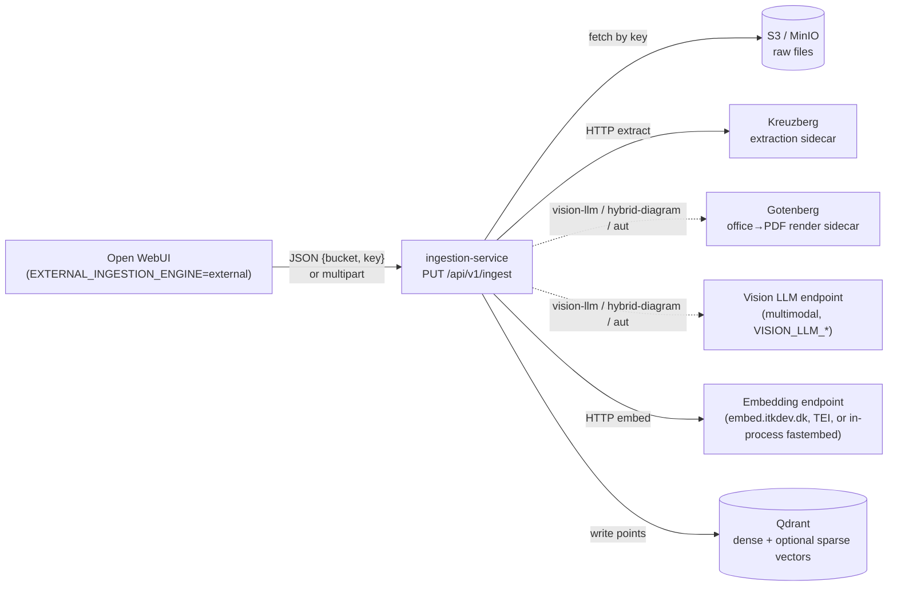
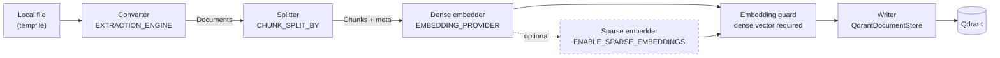
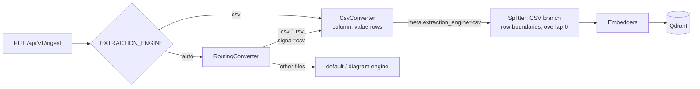

# Ingestion Service

Document ingestion microservice for [AarhusAI](https://github.com/AarhusAI).
A standalone FastAPI service that runs a [Haystack v2](https://haystack.deepset.ai/)
indexing pipeline (extract → chunk → embed → store) and writes Haystack-native documents
to Qdrant. The pluggable extraction engine, dense embedder, and optional sparse embedder
are all driven by configuration — the service isn't bound to any specific embedding model.

Called by Open WebUI when `EXTERNAL_INGESTION_ENGINE=external`. The Open WebUI patch
delegates to `PUT /api/v1/ingest` with either an S3 reference (preferred) or a multipart
file upload.

## How Ingestion Works

The service is a thin FastAPI shell around a Haystack v2 pipeline. FastAPI handles
transport, auth, and the temp-file lifecycle; the pipeline does the actual work
(extract → chunk → embed → write). The pipeline is built once at lifespan startup
and cached as module-level state — Haystack pipelines aren't cheap to construct and
the sparse embedder downloads its model on first warm-up.

### System Context

Where the service sits in the broader stack and what it talks to:



Open WebUI uploads the raw file to S3/MinIO first, then calls `PUT /api/v1/ingest`
with the bucket + key. The multipart fallback exists for direct uploads but the
S3 path is preferred — it keeps large files off the FastAPI worker's heap.

### Pipeline DAG

What happens to the file once the route handler hands it off to
`run_indexing_pipeline()`:



Each stage, in order:

- **Converter** (`app/pipelines/converters.py`) — turns the raw file into one or
  more Haystack `Document` objects. Factory dispatches on `EXTRACTION_ENGINE`:
  `kreuzberg` is an HTTP sidecar, `pypdf` is in-process,
  `docling` / `unstructured` require optional deps. Kreuzberg uses a custom
  Haystack component (`app/pipelines/kreuzberg_converter.py`) that additionally
  surfaces document-level metadata (title, authors, languages) and renders
  embedded tables as Markdown. `vision-llm` renders pages and reconstructs
  layout-bound documents (flowcharts, scans) via a multimodal LLM; `hybrid-diagram`
  pairs native docx text with a vision-inferred Mermaid graph. See
  [Extraction Engines](#extraction-engines).

- **Splitter** (`app/pipelines/splitter.py`) — slices documents into chunks.
  Three factory branches selected by `CHUNK_SPLIT_BY`: `HuggingFaceTokenizerSplitter`
  (token mode — measures chunk size in the embedding model's actual
  tokens), `MarkdownChunker` (markdown mode, default — splits on heading hierarchy first,
  merges sections smaller than `CHUNK_MIN_SIZE` tokens into their neighbors,
  then token-packs sections; attaches the `meta.headers` breadcrumb plus its
  joined string form `meta.headers_breadcrumb`), or Haystack's
  built-in `DocumentSplitter` (word / sentence / passage modes). All branches
  attach `meta.split_id` (sequential chunk index within the file).

- **Dense embedder** (`app/pipelines/embedders.py`) — turns each chunk's text
  into a fixed-size vector. Required. Three providers selected by
  `EMBEDDING_PROVIDER`: `openai-compat` (HTTP, the current `embed.itkdev.dk`
  path), `fastembed` (in-process), `tei` (HTTP, OpenAI-compatible wire format).
  Applies `EMBEDDING_PREFIX_DOC` to each chunk before embedding so e5/nomic
  models get the prefix they were trained on. With `EMBED_HEADERS_BREADCRUMB=true`
  (default) both the dense and sparse embedders also prepend the chunk's
  `meta.headers_breadcrumb` (markdown mode's section path, e.g.
  `Setup > Docker > Networking`) to the text they encode — the full heading
  hierarchy steers the vector while the stored chunk content stays clean.

- **Sparse embedder** (`app/pipelines/embedders.py`) — when
  `ENABLE_SPARSE_EMBEDDINGS=true` (default), adds a second named vector per chunk
  (BM42 / SPLADE family via fastembed). Lets the retrieval agent use Qdrant's
  native RRF hybrid query at search time instead of client-side BM25. Skipped
  entirely when disabled — the writer sees dense-only chunks.

- **Writer** — `DocumentWriter` backed by `QdrantDocumentStore`. Writes the
  dense vector (and the sparse vector when enabled) as named vectors on a single
  Qdrant point per chunk. Multitenancy HNSW is configured at the store layer
  (`hnsw_config={"m": 0, "payload_m": 16}`) and the per-tenant subgraph key is
  `meta.collection_name`; its keyword payload index is created by
  `app/services/qdrant_setup.py` at startup.

### CSV Ingestion

Flat-text extraction breaks tables: once the splitter cuts past the first rows,
later chunks carry values without their column names (`25`, `Aalborg` — of
what?). `.csv` / `.tsv` files therefore get their own in-process engine that
writes every row as self-describing `column: value` lines, and a splitter branch
that keeps rows whole.



1. **Routing** — under `auto`, `classify_engine()` sends `.csv` / `.tsv` to `csv`
   (`signal=csv`, visible in the INFO log, the ingest response's `extraction`
   object, and chunk meta). `EXTRACTION_ENGINE=csv` pins it directly.
2. **`CsvConverter`** (`app/pipelines/csv_converter.py`, stdlib `csv`, no sidecar)
   — decodes UTF-16 (BOM, Excel "Unicode Text") or `utf-8-sig`, falling back to
   `cp1252` (Danish Excel, undefined bytes replaced); delimiter from an Excel
   `sep=X` first line, tab for `.tsv`, else `csv.Sniffer` over `;` `,` tab
   (header-line count as fallback); treats row 1 as the header (empty header
   cells and cells past the header become `column N`); collapses whitespace inside
   cells so a quoted line break can't fake a row boundary; drops empty values and
   blank rows; joins rows with a blank line. Read/parse failures raise
   `EXTRACTION_FAILED`.
3. **Splitter** — for documents with `meta.extraction_engine == "csv"`, both
   token and markdown modes cut only at the blank lines between rows, with zero
   overlap (rows carry their own context; overlap would only store rows twice).
   Markdown mode also skips its heading split, which would otherwise collapse the
   blank lines between rows.

Example — a `;`-separated cp1252 export:

```text
navn;alder;by
Søren;52;Århus
;;
Mette;;København
```

becomes:

```text
navn: Søren
alder: 52
by: Århus

navn: Mette
by: København
```

Known limits: the whole file is read into memory; row 1 is always the header;
a single row wider than the chunk budget is split between its lines; `word` /
`sentence` / `passage` modes have no CSV branch; a pinned non-CSV engine (e.g.
`EXTRACTION_ENGINE=kreuzberg`) still gets CSVs as flat text; `.xlsx` isn't
handled here.

### Idempotency

Overwrites are **versioned (blue/green)**: every run stamps a fresh
`meta.ingest_version` onto its chunks (which also gives them new Haystack
document IDs), so the new version is written *alongside* any existing points.
Only after the pipeline succeeds — and produced at least one chunk — does
`_delete_stale_versions()` sweep every other version of that file, scoped per
`meta.file_id` + `meta.collection_name` (when `overwrite=true`, the default) —
copies of the same file in other collections (`file-<id>`, other KBs) are
kept. If the pipeline throws at any stage,
`_delete_ingest_version()` tears down only the failed run's own points. The
contract for callers is:

- A `status: true` response means the file is fully indexed (all chunks
  written, all vectors present) and stale versions are swept.
- A failed run leaves the **previously indexed version untouched** — the file
  stays searchable with its old content; the failed run's partial writes are
  torn down.
- A run that extracts zero chunks reports success but keeps the previous
  version — an empty extraction never replaces a good index with nothing.
- Retries with the same `file_id` are safe; no duplicate vectors (the query
  window where old and new versions coexist lasts only until the sweep, i.e.
  moments after the write).

Open WebUI's reindex action depends on this contract.

### Code Tour

Where to start reading when you need to change something:

| File | What lives there |
| --- | --- |
| `app/main.py` | FastAPI app, lifespan, health endpoints |
| `app/routes/ingest.py` | `PUT /api/v1/ingest` — auth, content-type dispatch, temp-file lifecycle, error code mapping |
| `app/routes/extract.py` | `POST /api/v1/extract` — developer-facing extraction probe |
| `app/pipelines/indexing.py` | Pipeline DAG construction, idempotency, exception teardown |
| `app/pipelines/converters.py` | Converter factory (`EXTRACTION_ENGINE` dispatch) |
| `app/pipelines/kreuzberg_converter.py` | Custom Haystack component for the Kreuzberg HTTP sidecar |
| `app/pipelines/csv_converter.py` | `csv` engine — `.csv`/`.tsv` rows → `column: value` text |
| `app/pipelines/routing_converter.py` | `auto` mode — per-document engine routing (docx signals live in `detectors.py`) |
| `app/pipelines/vision_llm_converter.py` | `vision-llm` engine — page render → multimodal LLM → Markdown + Mermaid |
| `app/pipelines/hybrid_diagram_converter.py` | `hybrid-diagram` engine — native docx text + vision-inferred diagram |
| `app/pipelines/vision_profiles.py` | Vision prompt profiles + the `KNOWN_PROFILES` registry |
| `app/pipelines/rendering.py` | Page rendering — office→PDF via Gotenberg, PDF→PNG local |
| `app/pipelines/splitter.py` | Splitter factory + custom HF tokenizer / Markdown chunkers |
| `app/pipelines/embedders.py` | Dense (required) + sparse (optional) embedder factories |
| `app/services/qdrant_setup.py` | Payload-index bootstrap (`collection_name`, `collection_type`, `languages`, `file_id`, `ingest_version`) |
| `app/services/s3.py` | S3 fetch for JSON-mode ingest requests |
| `app/config.py` | pydantic-settings env binding (single source of truth for config) |
| `app/models.py` | Request / response Pydantic schemas |

## Requirements

- Docker and Docker Compose
- [Task](https://taskfile.dev/) (Go Task runner)
- A Qdrant instance (shared with the retrieval agent)
- An OpenAI-compatible embedding endpoint (e.g. the `embed.itkdev.dk` proxy)
- An extraction sidecar reachable on the same network: a Kreuzberg API server
  (the `EXTRACTION_ROUTER_DEFAULT` under the default `EXTRACTION_ENGINE=auto`,
  so ordinary documents go to it out of the box). It ships as a container in
  the parent stack. See
  [Extraction Engines](#extraction-engines) for the full matrix.
- **For the vision engines** (`vision-llm`, `hybrid-diagram`, or the default
  `auto` when it routes a diagram-heavy document — without them those documents
  fail with `EXTRACTION_FAILED`; pin `EXTRACTION_ENGINE=kreuzberg` to avoid): a [Gotenberg](https://gotenberg.dev/)
  sidecar for office→PDF rendering — bundled in this repo's own
  `docker-compose.yml`, so `docker compose up` starts it for you — **and** an
  OpenAI-compatible multimodal LLM endpoint (configured via `VISION_LLM_*`).
  These are inert unless a vision engine is actually selected.

## Quick Start

### Local Development

```shell
cp .env.example .env
# Edit .env — at minimum set API_KEY and EMBEDDING_API_KEY. The other defaults
# in .env.example (EXTRACTION_ENGINE=auto,
# EMBEDDING_API_BASE_URL=https://embed.itkdev.dk/v1, MinIO, Qdrant, and the
# Kreuzberg sidecar URL) are the working Aarhus dev values; only override
# when pointing at something else. auto sends diagram-heavy docx to the vision
# engine, so also set VISION_LLM_API_BASE_URL + VISION_LLM_API_KEY (or pin
# EXTRACTION_ENGINE=kreuzberg).

# Generate a secure API key:
python -c "import secrets; print(secrets.token_urlsafe(32))"

# Where the same secret has to land:
#   - standalone:    set as API_KEY in this service's .env.
#   - parent stack:  set as INGESTION_API_KEY in the parent .env. The parent
#                    docker-compose forks it into two places — this service's
#                    API_KEY and the openwebui container's
#                    EXTERNAL_INGESTION_API_KEY. You do not set the latter two
#                    by hand.

# The 'frontend' network is external (created by Traefik in the parent stack).
# Running standalone, create it once — a no-op if it already exists:
docker network create frontend

task setup                           # docker compose up -d --wait + install dev deps
docker compose logs -f ingestion     # tail ingestion container logs
```

Container lifecycle has no `task` wrappers — the Taskfile only proxies
in-container commands (`docker compose exec ingestion …`). Use `docker compose`
directly for start/stop/build/shell:

```shell
docker compose up -d                 # start containers
docker compose down                  # stop containers
docker compose restart ingestion     # restart just the app container
docker compose build                 # rebuild the image
docker compose exec ingestion bash   # open a shell in the ingestion container
docker compose logs -f ingestion     # tail logs
```

The `task` commands (each runs inside the ingestion container):

```shell
task setup          # first-time: docker compose up -d --wait + install dev deps
task install        # (re)install dev deps from uv.lock (uv sync --frozen --extra dev)
task lock           # re-lock after editing pyproject.toml (task lock -- --upgrade to bump versions)
task lint           # run all linters (ruff check + ruff format --check + basedpyright)
task lint:types     # type-check (basedpyright; only errors not in .basedpyright/baseline.json fail)
task lint:fix       # auto-fix lint issues (ruff check --fix)
task lint:format    # format code (ruff format)
task test           # run all tests (pytest -v)
task test:coverage  # run tests with coverage report
task audit          # security audit: pip-audit (CVEs) + bandit (static scan); advisory only
task audit:deps     # scan installed deps for known CVEs (pip-audit --strict)
task audit:code     # static security scan of app/ (bandit -ll)
task ci             # lint + test
```

Run a single test (or one test in a file):

```shell
docker compose exec ingestion pytest tests/test_ingest_endpoint.py -v
docker compose exec ingestion pytest tests/test_ingest_endpoint.py::test_json_mode_happy_path -v
```

### Production Image

```shell
task build:image                              # build + push multi-arch (linux/amd64 + linux/arm64) to ghcr.io/aarhusai/ingestion-service:latest
task build:image TAG=v1.0.0                   # with specific tag
task build:image PLATFORMS=linux/amd64        # single-arch (skips QEMU emulation; much faster for local iteration)
```

First run will create a buildx builder (`ingestion-service-builder`) and register QEMU binfmt handlers for
cross-arch emulation — idempotent, no-op on subsequent runs.

## Health Endpoints

- `GET /health` — liveness probe (always 200 if the process is running)
- `GET /health/ready` — readiness probe. Returns 503 until the Haystack pipeline has finished warming up (the sparse
  embedder pulls its model from HuggingFace on first boot — ~80 MB) **and** Qdrant is reachable. This keeps Docker /
  Kubernetes from routing traffic during cold start.

## API

### `PUT /api/v1/ingest`

Two transport modes share one endpoint and dispatch on `Content-Type`.

#### S3-reference mode (preferred)

```http
PUT /api/v1/ingest HTTP/1.1
Authorization: Bearer <API_KEY>
Content-Type: application/json

{
  "s3_bucket": "openwebui",
  "s3_key": "files/abc/report.pdf",
  "file_id": "abc",
  "filename": "report.pdf",
  "collection_name": "file-abc",
  "collection_type": "file",
  "user_id": "u-1",
  "overwrite": true
}
```

#### Multipart fallback

```http
PUT /api/v1/ingest HTTP/1.1
Authorization: Bearer <API_KEY>
Content-Type: multipart/form-data; boundary=...

# fields:
file=<binary>
file_id=abc
filename=report.pdf
collection_name=file-abc
collection_type=file
user_id=u-1
overwrite=true
```

#### Response

```json
{
  "status": true,
  "collection_name": "file-abc",
  "chunks_count": 42
}
```

With `EXTRACTION_ENGINE=auto`, the response also carries an `extraction` object
recording which engine handled the document and why:

```json
{
  "status": true,
  "collection_name": "file-abc",
  "chunks_count": 42,
  "extraction": {
    "engine": "hybrid-diagram",
    "route": {"signal": "textbox", "textboxes": 50, "body_words": 5, "ratio": 8.33}
  }
}
```

`route` is `null` (and the whole `extraction` object omitted) for a pinned
engine, where no classification step runs.

#### Error

```json
{
  "status": false,
  "error": "human-readable message",
  "code": "EXTRACTION_FAILED"
}
```

Codes: `EXTRACTION_FAILED`, `EMBEDDING_FAILED`, `SPARSE_EMBEDDING_FAILED`,
`QDRANT_WRITE_FAILED`, `S3_FETCH_FAILED`, `INVALID_REQUEST`, `PIPELINE_FAILED`.

#### Idempotency

When `overwrite=true` (default), the new version is written first, then every
other version of the file is swept, per `meta.file_id` + `meta.collection_name`
(copies of the file in other collections are kept). Retries are safe — no
duplicates. On any pipeline failure only the failed run's own points are torn
down, so partial writes never leak into Qdrant.

### `POST /api/v1/extract`

Developer-facing extraction probe: runs the configured Haystack converter
against an uploaded file and returns the raw extracted documents. No chunking,
no embedding, no Qdrant writes. Useful for sanity-checking how a given engine
sees a document before committing to a full ingest, and for comparing engines
side-by-side without restarting the container.

Multipart-only. Same Bearer-token auth as `/api/v1/ingest`.

Fields:

- `file` (required) — the document to extract.
- `engine` (optional) — one of
  `pypdf | docling | unstructured | kreuzberg | vision-llm | hybrid-diagram | csv`.
  Overrides `EXTRACTION_ENGINE` for this single request. When omitted, the
  configured default is used. `auto` is a routing *mode* for ingest, not a
  concrete converter, so it is **not** accepted here — pick the engine you want
  to probe directly.
- `profile` (optional) — vision-llm prompt profile. One of
  `diagram | diagram-topology | general | figure | ocr` (the full profile
  registry; `diagram-topology` and `figure` are primarily the auto / hybrid
  internal profiles, but the endpoint accepts them too for probing). Accepted
  only by the profile-aware engines — `vision-llm` and `hybrid-diagram` (where
  it pins the vision fallback profile); supplying it for any other engine is a
  `400 INVALID_REQUEST`. When omitted, the engine's configured default applies
  (`VISION_LLM_PROFILE` for `vision-llm`; `hybrid-diagram` auto-selects per
  document).

#### Example

```shell
curl -X POST \
  -H "Authorization: Bearer $API_KEY" \
  -F file=@sample.pdf \
  -F engine=pypdf \
  http://localhost:8000/api/v1/extract
```

#### Response

```json
{
  "status": true,
  "engine": "pypdf",
  "profile": null,
  "documents": [
    {"content": "# Heading\n...", "meta": {"page": 1}},
    {"content": "...",            "meta": {"page": 2}}
  ]
}
```

`profile` echoes the vision-llm prompt profile actually used (e.g. `"diagram"`),
and is `null` for the non-vision engines.

Errors use the same `IngestError` shape as `/api/v1/ingest`. Codes returned:
`INVALID_REQUEST` (unknown engine, missing file, missing optional dependency
for `docling`/`unstructured`) and `EXTRACTION_FAILED` (converter raised at
runtime). Note that `engine=unstructured` is wired in but its converter uses
a `paths=` input socket Haystack's pipeline doesn't currently route to — the
ingest pipeline has the same limitation; this endpoint will surface it as
`EXTRACTION_FAILED`.

### `DELETE /api/v1/documents/{file_id}`

Removes a file's chunks from Qdrant — the symmetric counterpart to
`PUT /api/v1/ingest`. Open WebUI calls this when a file is deleted so its
vectors don't outlive the file (the vector store lives here now, not inside
Open WebUI, so OWUI's own cleanup no longer reaches it). Same Bearer-token auth
as `/api/v1/ingest`.

Idempotent: deleting an unknown or already-gone `file_id` returns `200` with
`chunks_deleted: 0`, so the caller can fire it unconditionally and retry.

```shell
curl -X DELETE \
  -H "Authorization: Bearer $API_KEY" \
  http://localhost:8000/api/v1/documents/abc
```

```json
{
  "status": true,
  "file_id": "abc",
  "chunks_deleted": 42
}
```

Returns `503` (`PIPELINE_FAILED`) until the pipeline has warmed up, and `500`
(`DELETE_FAILED`) if the Qdrant delete itself fails — both use the same
`IngestError` shape as `/api/v1/ingest`.

## Observability

Four layers of insight into how documents are ingested:

- **Log verbosity** — `LOG_LEVEL` (`DEBUG | INFO | WARNING | ERROR | CRITICAL`)
  is the primary dial, applied to the root logger. The per-document routing
  decision logs at **INFO** (`routing X.docx -> engine=… signal=… profile=…`);
  the detailed detector metrics (textbox counts, ratios, image area) log at
  **DEBUG**. `LOG_LEVEL_APP` optionally overrides just the `app` namespace, so
  you can run verbose app logs without the third-party DEBUG flood (httpx /
  boto3 / haystack); empty inherits `LOG_LEVEL`. (`DEBUG=true` is unrelated to
  verbosity — it only reflects `str(exc)` in error responses for triage.)
- **Structured logs** — `LOG_FORMAT=json` emits one JSON object per line
  (`ts`, `level`, `logger`, `msg`, plus any structured `extra=` fields) for
  Loki / a JSON-aware log pipeline. `text` (default) keeps the human format.
- **Classification visibility** — which engine each document hit, and why, is
  surfaced three ways: the INFO log line, the ingest response's `extraction`
  object, and persisted onto every chunk's `meta` (`extraction_engine`,
  `extraction_route`) so it's queryable after the fact in Qdrant (e.g. its
  web UI).
- **Prometheus metrics** — `GET /metrics` (set `METRICS_ENABLED=true`, the
  default; `false` → 404). Bearer-authenticated with the same `API_KEY` as
  `/api/v1/ingest` (mirrors retrieval-agent) — the scrape job must send
  `Authorization: Bearer <API_KEY>`. Exposes:
  `ingest_requests_total{outcome,code}`, `delete_requests_total{outcome,code}`,
  `ingest_duration_seconds`, `ingest_chunks`, `ingest_empty_total` (successful
  ingests that wrote zero chunks — a silent extraction failure otherwise looks
  healthy), `ingest_document_bytes`, `extraction_route_total{engine,signal}`,
  and `pipeline_stage_duration_seconds{stage}` (per component — the
  `dense_embedder` stage is the bottleneck under load).

## Configuration

All config is via environment variables loaded by pydantic-settings
(`app/config.py`). Every setting is listed in the [reference](#reference) below;
`.env.example` carries the longer rationale per setting. The settings that
matter beyond their docstrings because they are **contracts with other services**:

- `API_KEY` must equal Open WebUI's `EXTERNAL_INGESTION_API_KEY` (and the
  retrieval agent's parallel value when querying the same data).
- `EMBEDDING_MODEL`, `EMBEDDING_DIM`, and `EMBEDDING_PREFIX_DOC` must match
  whatever the retrieval agent uses at query time. e5 needs `"passage: "` on
  documents and `"query: "` on queries; bge-m3 takes no prefix; nomic uses
  `"search_document: "` / `"search_query: "`.
- `QDRANT_INDEX` is the physical Qdrant collection. Defaults to
  `ingestion_files` — distinct from Open WebUI's legacy multitenancy collections.
- `ENABLE_SPARSE_EMBEDDINGS=true` (default) adds a sparse vector to each Qdrant
  point so the retrieval agent can use Qdrant's native hybrid query (RRF fusion)
  instead of the legacy client-side BM25. It's fixed when the collection is
  created — flipping it against an existing `QDRANT_INDEX` fails at startup.
- `EMBEDDING_THREADS` caps the ONNX thread pool of the in-process fastembed
  embedders (the sparse BM42 model, and the dense embedder when
  `EMBEDDING_PROVIDER=fastembed`). ONNX otherwise grabs every core, saturating
  CPU mid-ingest so the uvicorn event loop can't answer `/health` and Docker
  restarts the container. `0` (default) = auto: leave 2 cores free for the event
  loop; a positive value pins the count. Auto can't see a `cpus:` CFS quota, so
  set it explicitly if you CPU-limit the container. `OMP_NUM_THREADS` (default
  `4`) backstops onnxruntime's OpenMP/BLAS kernels and must be an env var (it is
  read at native-library load time, before any Python runs).
- `CHUNK_SPLIT_BY` selects the chunking strategy (default `markdown`). `token` mode
  measures `CHUNK_SIZE` / `CHUNK_OVERLAP` in the embedding model's actual
  HuggingFace tokens (via `RecursiveCharacterTextSplitter.from_huggingface_tokenizer`)
  so chunks respect the model's context window — important for e5-large's
  512-token cap once the `"passage: "` prefix is prepended. `markdown` mode is
  structure-aware: it splits on Markdown headings (`#`, `##`, `###`) first,
  merges adjacent sections smaller than `CHUNK_MIN_SIZE` tokens (default 100,
  `0` disables — never past `CHUNK_SIZE`; merged chunks keep the
  longest-common-prefix heading path so the breadcrumb stays truthful),
  then token-packs each section that exceeds `CHUNK_SIZE`, and writes the
  heading breadcrumb to `meta.headers` on each chunk (plus the joined
  `meta.headers_breadcrumb`, which `EMBED_HEADERS_BREADCRUMB=true` feeds into
  the embedders) — most useful when the
  converter emits Markdown (Docling natively, Kreuzberg with table rendering).
  `word`, `sentence`, and `passage` delegate to Haystack's built-in
  `DocumentSplitter` and count in those units instead. Token and markdown
  modes use `TOKENIZER_MODEL` if set, otherwise fall back to `EMBEDDING_MODEL`.
- `EMBEDDING_CONNECT_TIMEOUT` / `EMBEDDING_READ_TIMEOUT` / `EMBEDDING_MAX_RETRIES`
  (defaults `5.0` / `30.0` / `16`) are the dense embedder's HTTP budget, applied to
  the `openai-compat` and `tei` providers (`fastembed` is in-process). Connect and
  read are split deliberately — a blackholed endpoint fails in 5 s per attempt
  while a slow-but-alive one still gets 30 s — and that is what makes the retry
  count affordable. With openai's backoff (`min(0.5·2ⁿ, 8)` s, jittered downward),
  16 retries absorb **~78–104 s** of endpoint downtime rather than failing the
  user's upload, for a worst case of ~189 s. Left unset, Haystack substitutes
  `timeout=30.0, max_retries=5`, which absorbs only ~13 s. The cost is bounded per
  *ingest* rather than per batch, because `raise_on_failure=True` aborts on the
  first failing batch; keep the worst case inside the caller's
  `EXTERNAL_INGESTION_TIMEOUT` (900 s in the parent stack).
- `EMBEDDING_MAX_TOKENS` (default `512`) is the served model's hard input limit
  and the ceiling both HF-aware chunking modes size against. `CHUNK_SIZE` counts
  chunk *content* only, but the embedder sends `EMBEDDING_PREFIX_DOC` + the
  heading breadcrumb + the content, and the tokenizer adds special tokens — so
  the effective content budget is `min(CHUNK_SIZE, EMBEDDING_MAX_TOKENS − prefix
  − breadcrumb − specials − margin)`, recomputed per section in `markdown` mode
  because the breadcrumb's cost varies (measured 1–53 tokens on real documents).
  A `CHUNK_SIZE` that already fits is left untouched, so the default `400`
  produces exactly the chunks it always did; a too-large value is clamped with an
  INFO log naming both numbers rather than failing startup. Getting this wrong is
  not a soft failure: the endpoint rejects the **entire batch** (32 chunks) when
  one input is oversized.

### Reference

Defaults are the `app/config.py` values. **Bold** = set or review before production.

#### Auth & server

| Variable | Default | Purpose |
| --- | --- | --- |
| **`API_KEY`** | *(required, ≥32 chars)* | Bearer token for every protected endpoint; must equal Open WebUI's `EXTERNAL_INGESTION_API_KEY` |
| **`DEBUG`** | `false` | Reflect raw `str(exc)` in error responses. Leaks hostnames/paths — keep `false` in production |
| `MAX_UPLOAD_BYTES` | `104857600` (100 MB) | Per-request size cap for multipart uploads and S3 fetches |

#### Logging & observability

| Variable | Default | Purpose |
| --- | --- | --- |
| `LOG_LEVEL` | `INFO` | Root log level (third-party libs follow it) |
| `LOG_LEVEL_APP` | *(empty = inherit)* | Override for the `app.*` loggers only |
| `LOG_FORMAT` | `text` | `text` or `json` (one object per line, for Loki) |
| `METRICS_ENABLED` | `true` | Expose `GET /metrics` (bearer-auth); `false` → 404 |

#### Extraction

| Variable | Default | Purpose |
| --- | --- | --- |
| `EXTRACTION_ENGINE` | `auto` | Engine or `auto` routing — see [Extraction Engines](#extraction-engines) |
| `KREUZBERG_URL` | `http://kreuzberg:8000` | Kreuzberg sidecar |
| `KREUZBERG_CONNECT_TIMEOUT` / `KREUZBERG_READ_TIMEOUT` | `5.0` / `60.0` | Fail fast on connect; extraction is CPU-bound, so read is long |
| `KREUZBERG_TLS_VERIFY` | `true` | Explicit so `verify=False` can't be introduced silently |
| `KREUZBERG_MIN_TABLE_COLUMNS` | `2` | Drop detected "tables" narrower than this (the detector misfires on prose, emitting 1-column duplicates). `1` keeps all |

**Auto-routing** (only when `EXTRACTION_ENGINE=auto`)

| Variable | Default | Purpose |
| --- | --- | --- |
| `EXTRACTION_ROUTER_DEFAULT` | `kreuzberg` | Engine for ordinary documents |
| `EXTRACTION_ROUTER_DIAGRAM_ENGINE` | `hybrid-diagram` | Engine for diagram-heavy docx |
| `EXTRACTION_ROUTER_DIAGRAM_PROFILE` | `diagram` | Vision profile for the diagram route (mostly moot with `hybrid-diagram`, see below) |
| `EXTRACTION_ROUTER_MIN_TEXTBOXES` | `20` | Textbox floor so a few callouts don't trigger the diagram route |
| `EXTRACTION_ROUTER_DRAWING_RATIO` | `2.0` | Textbox text must be ≥ this × body words |
| `EXTRACTION_ROUTER_MIN_BODY_IMAGES` | `1` | Raster signal: minimum body images |
| `EXTRACTION_ROUTER_MIN_IMAGE_EMU` | `1500000000000` (≈1.79 in²) | Raster signal: largest image's display-area floor |
| `EXTRACTION_ROUTER_MIN_IMAGE_WORD_RATIO` | `0.0` (off) | Raster signal: optional image-area / body-words guard against decorative photos |

**Vision LLM** (`vision-llm`, `hybrid-diagram`, and `auto`'s diagram route)

| Variable | Default | Purpose |
| --- | --- | --- |
| **`VISION_LLM_API_BASE_URL`** / `VISION_LLM_API_KEY` | *(empty)* | OpenAI-compatible multimodal endpoint. Empty → diagram documents fail with `EXTRACTION_FAILED` under `auto` |
| `VISION_LLM_MODEL` | `gemma4-nvfp4` | Model id the endpoint serves |
| `VISION_LLM_CONNECT_TIMEOUT` / `VISION_LLM_READ_TIMEOUT` | `5.0` / `180.0` | A quantized VLM over several page images is slow |
| `VISION_LLM_DPI` | `150` | Page render resolution (legibility vs. image tokens) |
| `VISION_LLM_MAX_PAGES` | `20` | Hard page cap — bounds cost and quality drift |
| `VISION_LLM_MAX_TOKENS` | `16384` | Output cap; hitting it fails the extraction instead of indexing truncated Markdown |
| `VISION_LLM_TLS_VERIFY` | `true` | As for Kreuzberg |
| `VISION_LLM_LANGUAGE_HINT` | `Danish` | Keeps the model from translating the source text |
| `VISION_LLM_PROFILE` | `general` | Default profile for forced vision use: `diagram`, `general`, `ocr` |

**Gotenberg** (office → PDF for the vision engines)

| Variable | Default | Purpose |
| --- | --- | --- |
| `GOTENBERG_URL` | `http://gotenberg:3000` | Headless-LibreOffice sidecar |
| `GOTENBERG_CONNECT_TIMEOUT` / `GOTENBERG_READ_TIMEOUT` | `5.0` / `120.0` | LibreOffice conversion is the slow part |
| `GOTENBERG_TLS_VERIFY` | `true` | As for Kreuzberg |

#### Chunking

| Variable | Default | Purpose |
| --- | --- | --- |
| `CHUNK_SPLIT_BY` | `markdown` | `markdown`, `token`, `word`, `sentence`, `passage` |
| `CHUNK_SIZE` / `CHUNK_OVERLAP` | `400` / `80` | Chunk content size and overlap (tokens in token/markdown mode); clamped by `EMBEDDING_MAX_TOKENS` |
| `CHUNK_MIN_SIZE` | `100` | Markdown mode: merge sections smaller than this; `0` disables |
| `TOKENIZER_MODEL` | *(empty → `EMBEDDING_MODEL`)* | HuggingFace tokenizer used to size chunks |
| **`TOKENIZER_REVISION`** | *(empty = HEAD)* | Pin the tokenizer to a commit SHA so an upstream change can't shift chunk boundaries |

#### Dense embedder

| Variable | Default | Purpose |
| --- | --- | --- |
| `EMBEDDING_PROVIDER` | `openai-compat` | `openai-compat`, `tei`, or in-process `fastembed` |
| **`EMBEDDING_API_BASE_URL`** / **`EMBEDDING_API_KEY`** | *(empty)* | Embedding endpoint (required by compose) |
| `EMBEDDING_MODEL` / `EMBEDDING_DIM` | `intfloat/multilingual-e5-large` / `1024` | Must match the retrieval agent; dim is fixed per collection |
| `EMBEDDING_MAX_TOKENS` | `512` | Served model's hard input limit; chunk sizing ceiling |
| `EMBEDDING_PREFIX_DOC` | `"passage: "` | Document prefix from the model card. (`EMBEDDING_PREFIX_QUERY` in `.env.example` is for the retrieval agent; this service doesn't read it) |
| `EMBED_HEADERS_BREADCRUMB` | `true` | Prepend the markdown heading path to the embedded text |
| `EMBEDDING_CONNECT_TIMEOUT` / `EMBEDDING_READ_TIMEOUT` | `5.0` / `30.0` | HTTP budget per attempt |
| `EMBEDDING_MAX_RETRIES` | `16` | Rides out ~78–104 s of endpoint downtime |

#### Sparse embedder & CPU

| Variable | Default | Purpose |
| --- | --- | --- |
| `ENABLE_SPARSE_EMBEDDINGS` | `true` | Add a sparse vector per point for hybrid search. Fixed per collection at creation |
| `SPARSE_EMBEDDING_MODEL` | `Qdrant/bm42-all-minilm-l6-v2-attentions` | fastembed sparse model (~80 MB download on first boot) |
| `EMBEDDING_THREADS` | `0` (all cores − 2) | ONNX thread cap for in-process embedders. Set explicitly if the container is limited with `cpus:` |
| `OMP_NUM_THREADS` | `4` (Dockerfile/compose) | OpenMP backstop; env var only, keep ≤ `EMBEDDING_THREADS` |

#### Qdrant

| Variable | Default | Purpose |
| --- | --- | --- |
| `QDRANT_URI` | `http://qdrant:6333` | Vector store; readiness waits for it |
| **`QDRANT_API_KEY`** | *(none)* | Set whenever Qdrant is reachable beyond a trusted network |
| `QDRANT_INDEX` | `ingestion_files` | Physical collection shared by all tenants; must match the retrieval agent |

#### S3

| Variable | Default | Purpose |
| --- | --- | --- |
| `S3_ENDPOINT_URL` | *(empty = AWS)* | MinIO in dev, any S3-compatible store in prod |
| `S3_ACCESS_KEY_ID` / `S3_SECRET_ACCESS_KEY` | *(empty)* | Read-only credentials for Open WebUI's bucket |
| `S3_REGION` | `us-east-1` | Needed by boto3 for signing |
| **`S3_ALLOWED_BUCKETS`** | *(empty = unrestricted, startup warning)* | Comma-separated bucket allow-list. Without it, the request picks any bucket the credentials can read |

## Supported Embedding Models

| Model | Dim | Doc / query prefix | Native sparse |
| --- | --- | --- | --- |
| `intfloat/multilingual-e5-large` | 1024 | `"passage: "` / `"query: "` | — |
| `BAAI/bge-m3` | 1024 | none / none | yes |
| `jinaai/jina-embeddings-v3` | 1024 | task-specific | — |
| `nomic-ai/nomic-embed-text-v1.5` | 768 | `"search_document: "` / `"search_query: "` | — |

`EMBEDDING_PROVIDER`:

- `openai-compat` → `OpenAIDocumentEmbedder` (the current `embed.itkdev.dk` path)
- `fastembed` → `FastembedDocumentEmbedder` (in-process inference; supports BGE-M3 dense)
- `tei` → routes through `OpenAIDocumentEmbedder` (TEI exposes an OpenAI-compatible endpoint)

`ENABLE_SPARSE_EMBEDDINGS`:

- `true` → `FastembedSparseDocumentEmbedder` with `SPARSE_EMBEDDING_MODEL` (BGE-M3 sparse, BM42, SPLADE family)
- `false` → no sparse stage, dense-only pipeline

## Extraction Engines

| `EXTRACTION_ENGINE` | Status | Notes |
| --- | --- | --- |
| `kreuzberg` | day-one (`auto`'s default route) | HTTP sidecar — `goldziher/kreuzberg` container in the parent stack (`KREUZBERG_URL`). 91+ formats, fully local; switch to `-easyocr` / `-paddle` image tags for OCR |
| `pypdf` | day-one | In-process, PDF-only, lightweight |
| `docling` | optional dep | Add `docling-haystack` to `pyproject.toml` and rebuild |
| `unstructured` | optional dep | Add `unstructured-fileconverter-haystack` to `pyproject.toml` and rebuild |
| `vision-llm` | day-one | Renders pages (Gotenberg sidecar for office→PDF, local PDF→PNG) and reconstructs structure via a multimodal LLM (`VISION_LLM_*`). For flowcharts / diagrams / scanned forms whose meaning is in the layout |
| `hybrid-diagram` | day-one | For diagram `.docx`: native text from the package XML (authoritative, verbatim labels) + a vision-inferred diagram. Picks its vision profile per document — `diagram-topology` (Mermaid only) for a *vector* flowchart whose labels are Word shapes, or `figure` for a *raster* PNG diagram whose labels are pixels. Wraps `vision-llm`; non-docx falls through to it. The default diagram engine for `auto` |
| `csv` | day-one | In-process (stdlib). `.csv`/`.tsv` rows → `column: value` lines, rows separated by a blank line, so every chunk keeps its column names. Delimiter from Excel `sep=` line, tab for `.tsv`, else sniffed (`;` `,` tab); UTF-16 BOM / UTF-8 / cp1252 fallback; row 1 is the header. Token/markdown splitters cut these docs only between rows, zero overlap |
| `auto` | day-one (default) | Per-document routing: `.csv`/`.tsv` → `csv`; a `.docx` with a vector flowchart (drawing/textbox text outweighs body text) **or** a large body raster image (a flattened PNG diagram, zero textboxes) → `EXTRACTION_ROUTER_DIAGRAM_ENGINE` (default `hybrid-diagram`); everything else → `EXTRACTION_ROUTER_DEFAULT`. See `EXTRACTION_ROUTER_*` |

**`EXTRACTION_ROUTER_DIAGRAM_PROFILE`.** With the default diagram engine (`hybrid-diagram`)
this is mostly moot — for a real docx the hybrid path picks its own profile
(`diagram-topology` for vector flowcharts, `figure` for raster diagrams). It only applies to
hybrid's empty-docx fallback, or when you set `EXTRACTION_ROUTER_DIAGRAM_ENGINE=vision-llm`
(where it picks `diagram`/`general`/`ocr` for auto-routed flowcharts, independent of the
engine's own `VISION_LLM_PROFILE` default).

**Raster-diagram detection.** A `.docx` whose key content is a flattened raster PNG (a
process wheel, chart, or flowchart exported as an image) has zero textboxes, so the
text-vs-drawing signal never fires and a plain-text engine would drop the figure entirely.
A second signal catches it: a body image (DrawingML `<a:blip>` in `word/document.xml`) whose
largest rendered display area (`<wp:extent>`, EMU²) clears `EXTRACTION_ROUTER_MIN_IMAGE_EMU`
(default `1_500_000_000_000` ≈ 1.79 in²) routes to the diagram engine, which then uses the
`figure` profile. The area floor — not a count — is what rejects decoration: header/footer
logos are excluded for free (only `word/document.xml` is read), and an in-body logo/icon
falls below ~1.79 in² (a real diagram renders several in²). `EXTRACTION_ROUTER_MIN_BODY_IMAGES`
(default 1) gates the count, and the opt-in `EXTRACTION_ROUTER_MIN_IMAGE_WORD_RATIO` (default
0 = off) can additionally require image-area-to-body-words for corpora with large decorative
hero photos. **Edge:** the `figure` behaviour is specific to `hybrid-diagram`; if you set
`EXTRACTION_ROUTER_DIAGRAM_ENGINE=vision-llm`, raster docs use `EXTRACTION_ROUTER_DIAGRAM_PROFILE`
instead.

**Seeing what `auto` chose.** The `/extract` response echoes the `engine` and `profile`
used. On the `/ingest` path, every chunk carries `meta.extraction_engine` /
`meta.extraction_route` (and, for the vision engines, `meta.extractor` /
`meta.vision_profile`), the response includes an `extraction` object, and the routing
decision (`engine=… signal=…`) logs at INFO. Set **`LOG_LEVEL_APP=DEBUG`** to also log
the detector metrics (textbox: `textboxes`/`body_words`/`ratio`; raster:
`images`/`max_image_emu`) and the hybrid/vision branch.
